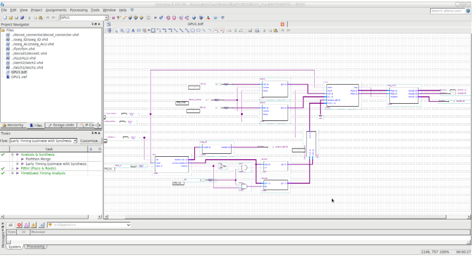
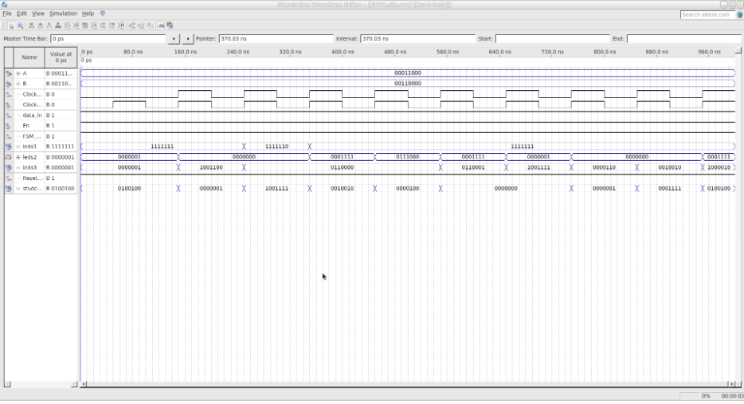
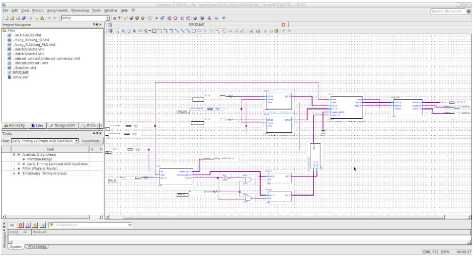
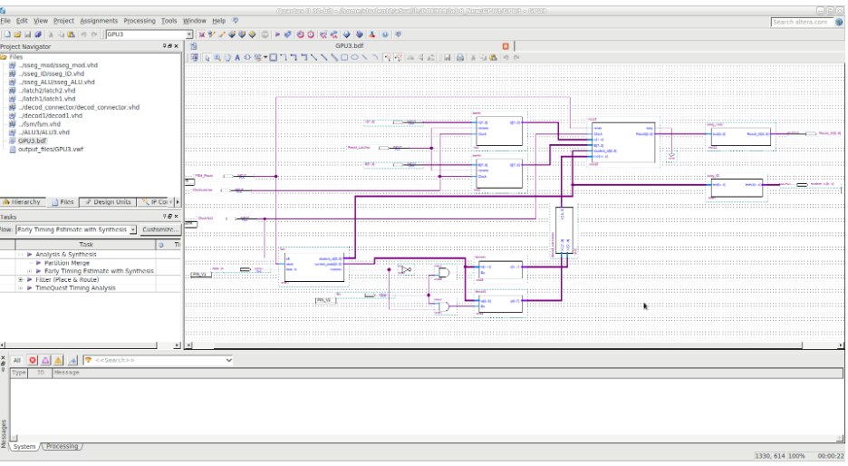
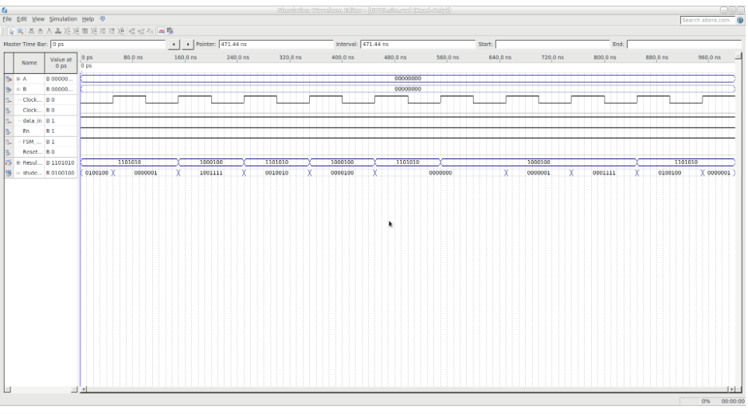
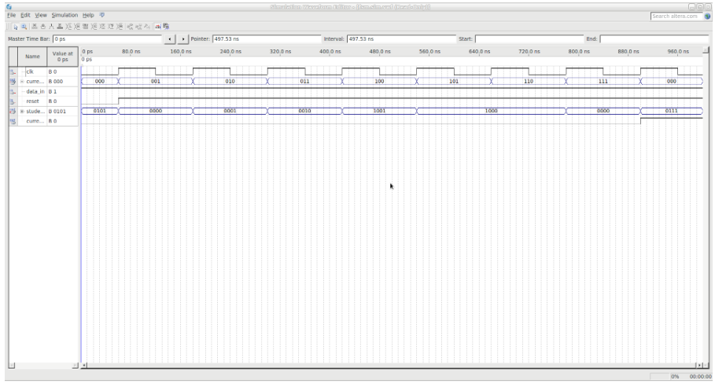
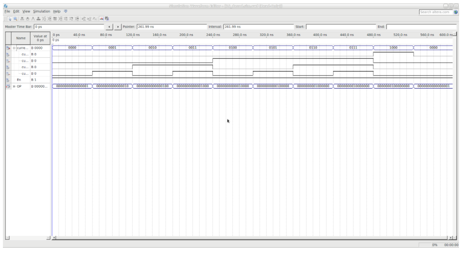
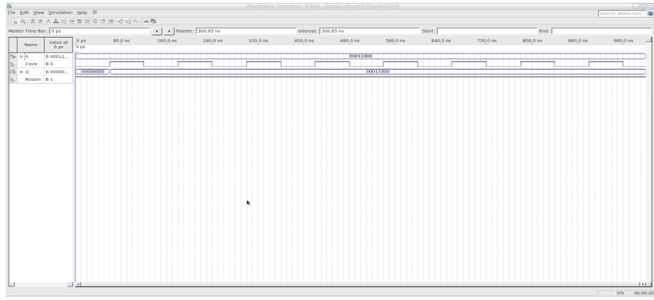

**Lab Report (PDF):** [Lab6_Report.pdf](docs/Lab6_Report.pdf)

# 8-Bit GPU System (VHDL / Quartus)

A small GPU-style digital system built in **VHDL** and **Intel Quartus** for COE328 at Toronto Metropolitan University. Two 8-bit inputs, A and B, are stored in latches. A finite state machine steps through 9 states, and a 4-to-16 decoder turns each state into a microcode that tells the ALU which operation to run. The result is split into two 4-bit halves and shown in hexadecimal on seven-segment displays.

## What's inside

- **Latches (x2):** copy A or B to the output on the rising clock edge, with an active-low reset
- **FSM:** 9 states that outputs the current state and a student ID digit at each step
- **4-to-16 decoder:** built from two 3-to-8 decoders, outputs a one-hot 16-bit microcode
- **ALU_1:** 9 operations (A+B, A-B, NOT A, NAND, NOR, AND, OR, XOR, XNOR) with a negative flag
- **ALU_2:** 9 custom operations, including shift right with '11' fill, (A-B)+4, Max(A, B), nibble swap, A+1, invert upper 4 bits, and rotate B left by 3
- **ALU_3:** checks whether a student ID digit is even or odd and outputs `1111` or `0000`
- **Seven-segment drivers:** hex display for R1 and R2, plus a modified display that shows `y` for even and `n` for odd
- **Waveform verification:** simulation screenshots for every component

## Project Structure

- `vhdl/` → VHDL source files
- `schematics/` → Quartus block diagram files (`.bdf`)
- `simulation/` → waveform files (`.vwf`)
- `images/` → screenshots used in this README
- `docs/` → lab report PDF

## System Overview

| Block | Role |
|---|---|
| Latch A / Latch B | Hold the 8-bit inputs A = `00011000`, B = `00110000` |
| FSM | Cycles through 9 states on each clock |
| 4-to-16 Decoder | Converts state to a 16-bit microcode |
| ALU | Runs the operation selected by the microcode |
| Seven-segment display | Shows R2 (upper 4 bits), R1 (lower 4 bits), and the negative sign |

### Microcode Table (4-to-16 decoder)

| State | Microcode |
|---|---|
| 0000 | `0000000000000001` |
| 0001 | `0000000000000010` |
| 0010 | `0000000000000100` |
| ... | one-hot pattern continues |
| 1000 | `0000000100000000` |

## Problem 1: Basic ALU

Nine arithmetic and logic operations on A and B. R1 is the lower 4 bits of the result and R2 is the upper 4 bits. The Neg output goes high when the result is negative.

## Problem 2: Custom ALU

Same structure as Problem 1, with different operations per microcode.

## Problem 3: Even/Odd Checker

Takes a student ID digit and outputs `1111` for even or `0000` for odd. A modified seven-segment decoder displays `y` for even and `n` for odd.

## Component Waveforms

### FSM

### 4-to-16 Decoder

### Latch A

## How to Open (Quartus)

1. Open **Intel Quartus**
2. Click **File → Open Project**
3. Select the `.qpf` project file
4. Open `GPU1.bdf`, `GPU2.bdf`, or `GPU3.bdf` for each problem
5. Compile the project
6. Run functional simulation to view the waveforms

## Tools Used

- Intel Quartus Prime
- VHDL
- Block diagram / symbol generation
- Quartus Waveform Editor
